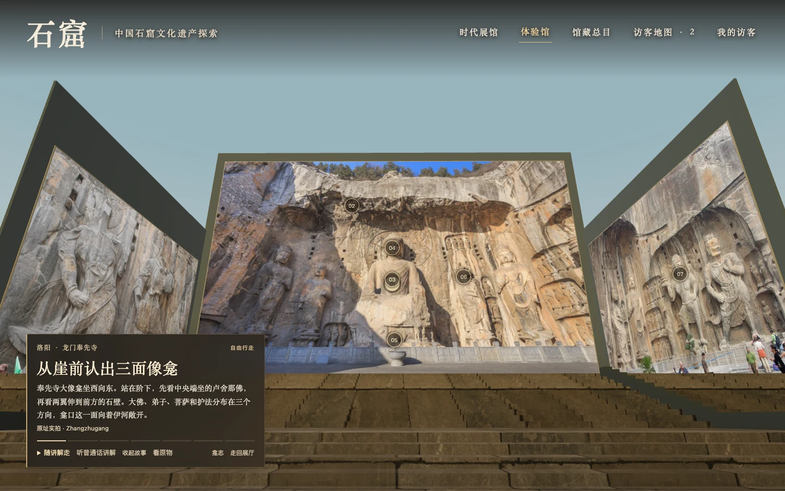
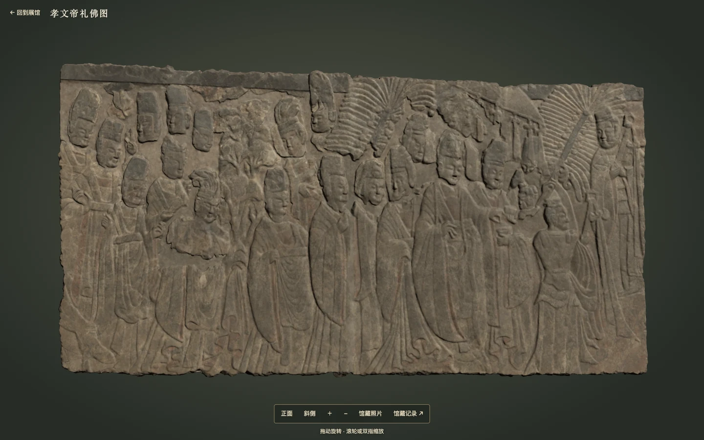

# ShiKu · Walk through China's Buddhist grottoes

**ShiKu is a 3D museum you can visit with other people in a browser.** At Mogao Cave 158 in Dunhuang, walk in through the east entrance, stop beside the reclining Buddha's pillow, then follow the guide around the figure to the wall painting where Kāśyapa arrives in mourning. At Fengxian Temple in Luoyang, your visit starts at the foot of the steps. Take in the whole group from below, climb to see the lowered eyes of Vairocana, then turn towards the guardian holding a pagoda on the north wall.

[Try ShiKu online](https://shiku.xiaoha.org/) · [中文](README.md) · [Collection catalogue](CATALOG.md) · [Visitor help](SUPPORT.md)



*Screenshot from the walk through Fengxian. ShiKu incorporates site photographs by Zhangzhugang, G41rn8 and Gary Todd. The screenshot is available under CC BY-SA 4.0.* [Image credits](docs/images/README.md)

## Pick your first stop

| Site | What to look for | Open in the demo |
| --- | --- | --- |
| **Mogao**, Dunhuang, Gansu · 73 exhibits | Cave 158 has eight stops. The head of the reclining Buddha is at the south end of the platform, with the feet to the north. An on-site photograph shows how the cheek rests on the pillows. As you continue around the figure, the guide follows the mourners painted on three walls. For a different kind of storytelling, look at the deer facing the king's chariot on the west wall of Cave 257. | [Walk around the reclining Buddha](https://shiku.xiaoha.org/?experience=mogao-158) · [See the nine-coloured deer](https://shiku.xiaoha.org/?structure=mogao-257) |
| **Yungang**, Datong, Shanxi · 30 exhibits | The seated Buddha of Cave 20 is now exposed to daylight. Look at the photograph of the seated figure and the standing Buddha to its east. Drag the divider to compare it with Di Luo's partial photogrammetric model from the same angle, then rotate the model to see the depth of the robe folds. | [Compare the Cave 20 photograph and scan](https://shiku.xiaoha.org/?structure=yungang-20&media=compare) |
| **Longmen**, Luoyang, Henan · 33 exhibits | Seven stops at Fengxian connect photographs of the west and side walls. Look for beam sockets in the cliff above the steps, stone petals beneath Vairocana's throne and the figure beneath the guardian's feet on the north wall. At Binyang Central Cave, examine The Met's 3D capture of the imperial procession relief. | [Approach Vairocana](https://shiku.xiaoha.org/?experience=longmen-1280) · [Inspect the relief](https://shiku.xiaoha.org/?structure=longmen-met-35146&media=compare) |
| **Maijishan**, Tianshui, Gansu · 43 exhibits | In Cave 133, compare a full frontal photograph of Stele 10 with the detail of its lower niche. The main figures occupy the central axis, with smaller narrative scenes arranged on either side. At Cave 4, follow the seven niches along the cliffside gallery to see how its painted sculpture was arranged. | [Enter Cave 133](https://shiku.xiaoha.org/?experience=maijishan-133) · [Explore the seven niches](https://shiku.xiaoha.org/?structure=maijishan-4) |

## Getting around

Pick the Qinghe or Xingchuan avatar and enter a nickname. A central atrium connects nine galleries arranged around periods of Chinese history. Walk through an opening to the next gallery, or select a period under **时代展馆** and use **本馆窟室** to find its cave rooms. The visitor interface and narration are in Chinese.

| What you'd like to do | How |
| --- | --- |
| Walk and look around | Use WASD, the arrow keys or click the floor. Drag to look around, scroll to change camera distance, and press V to switch between first-person and follow views. On touchscreens, tap the floor and drag to look around. |
| Take a narrated walk | Choose **随讲解走** in Mogao 158 or Fengxian. Enable **听普通话讲解** once and the guide starts the recording for each stop as you arrive. You can take over with the arrow keys. The 139 prerecorded clips use a single synthesized Mandarin voice and run for about 32 minutes in total. Text is available at each listening point. |
| Inspect a work | Click the frame or press F near it. Choose **看原物** to enlarge an available photograph or compare evidence for the object. Captions identify the object, photographer or collecting institution and link to the source. |
| Find someone in the museum | Open **访客地图** to see nicknames, positions and recent paths. Blue and red indicate the selected male and female avatars. The room admits up to 50 visitors. When it is full, each new visitor sees how many people are ahead and an estimated wait. |

The walkable scenes need a browser with **WebGL 2** and working graphics acceleration. If your device cannot start the scene, the period galleries still let you select works and read their stories. You can also browse the catalogue on GitHub. Choose a nickname you're comfortable showing to other visitors. [Catalogue](CATALOG.md) · [Visitor privacy](docs/PRIVACY.md)

## What is in the public edition?

The catalogue contains **179 exhibits**. The distribution includes photographs or scans for 94 of them. Another 85 have descriptions or links to institutional sources. There are **33 cave interpretation rooms and one manuscript room**. Of these 34 spaces, 23 include photographs of the corresponding objects and 11 are documentary interpretations. The atrium, connecting passages and walking distances were designed for this exhibition. Individual captures have their own scope. Di Luo's Cave 20 scan, for example, covers part of the site and preserves gaps at the edges of the survey. [Catalogue by site](CATALOG.md) · [Capture records](real-viewer/PROVENANCE.md)



*The imperial procession from Binyang Central Cave, now in The Metropolitan Museum of Art (35.146), as displayed in ShiKu. The museum supplies the scan and reference photograph under its Open Access policy.* [Image credits](docs/images/README.md) · [Object and capture record](assets/authentic/scans/SOURCES.md)

The manuscript room also brings paper objects into view. The British Library's **Or.8210/S.5458**, for instance, lets you compare the opening of the Heart Sutra, its text and the transition to the next section of the booklet. For further reading, the public catalogue indexes **891 cave and niche records** and **2,808 Dunhuang manuscript records** from the Bibliothèque nationale de France. Search by cave number, title or shelfmark. Each object record identifies the images included in the distribution. [Browse scriptures and prints](https://shiku.xiaoha.org/?catalog=art&pick=scripture) · [Cave register](https://shiku.xiaoha.org/?catalog=register) · [Manuscript index](https://shiku.xiaoha.org/?catalog=ms)

## Run it locally

Use **Node.js 22.12 or later**. Three.js, images, models and narration for the public edition ship with the project. From the directory containing `server/museum.mjs`, run the following command and open the [local museum](http://127.0.0.1:4173/).

```sh
node server/museum.mjs --port 4173
```

To try the RC1 snapshot under review while the first pull request is open, use the following commands. For active development, start a branch from the merged version as described in the contributing guide.

```sh
git clone https://github.com/pafa/ShiKu.git
cd ShiKu
git fetch origin refs/pull/1/head
git switch --detach a06accd0609e1fd5d3c894cb8b5825c64b81a44b
node server/museum.mjs --port 4173
```

Add `--lan` to host a visit for people on the same Wi-Fi and share the local address printed by the server. Press Ctrl+C to stop it. The local room clears when the Node process restarts. The hosted demo serves the site with Cloudflare Workers and keeps admissions, queued tickets and reconnections in a single SQLite-backed Durable Object. [Architecture](docs/ARCHITECTURE.md) · [Cloudflare deployment](deploy/cloudflare/README.md)

## Contribute and reuse

For research or teaching, cite the software and record the commit you used. When citing an individual object, use the creator, institution and source from its catalogue entry. [Cite ShiKu](CITATION.cff) · [Changelog](CHANGELOG.md) · [Code of conduct](CODE_OF_CONDUCT.md)

A useful collection correction can be as small as one cave number or a term in a narration script. Include the original caption, the proposed change and a museum record or publication that supports it. For a photograph or scan, include the creator, source, reuse conditions and any edits. For a walking, audio or multiplayer issue, include the visitor route, browser and steps to reproduce it. Changes go through a topic branch and a pull request. [Contributing](CONTRIBUTING.md) · [Help](SUPPORT.md) · [Security reports](SECURITY.md)

Original software is **Apache-2.0**. Original curatorial texts, guides, audio, entrance art and floor maps are **CC BY 4.0**, credited to **ShiKu**. Third-party photography, scans, models, motion data and catalogue records retain their respective terms. ShiKu is an independent project. Museum links lead to the institutions' records. [Software license](LICENSE) · [Content license](CONTENT-LICENSE.md) · [Asset credits](docs/ASSETS.md) · [NOTICE](NOTICE)
