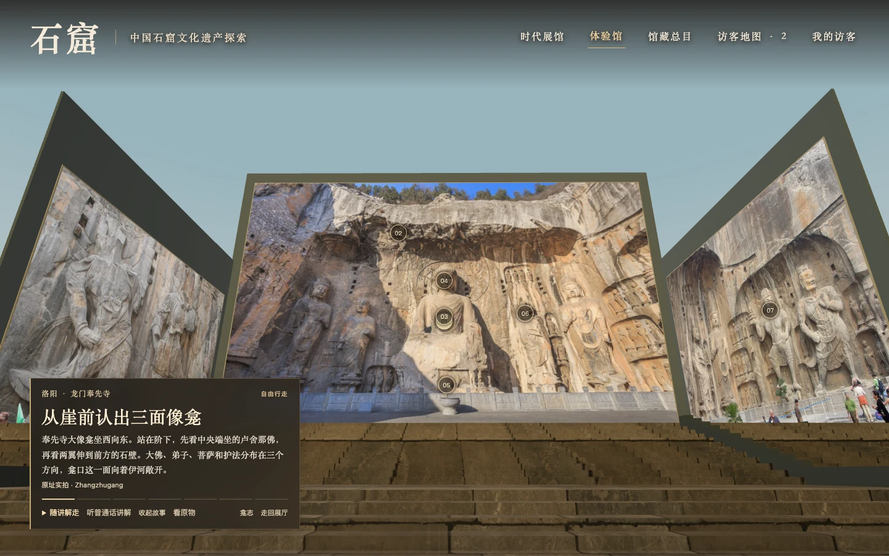
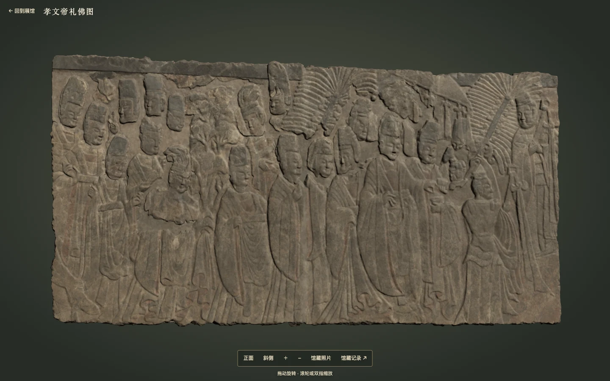

# ShiKu · 石窟

**一座可以与朋友一起参观的中国石窟 3D 数字展馆。** 在敦煌莫高窟第 158 窟，从东门走向卧佛的枕边，再沿佛身绕行，听讲解讲到身后壁画里赶来举哀的迦叶。到了洛阳龙门奉先寺，参观从崖前的石阶开始。站在阶下看群像，走上露台看卢舍那佛的眼睑，再转向北壁看天王手里的塔。

[在线试用](https://shiku.xiaoha.org/) · [English](README.en.md) · [馆藏目录](CATALOG.md) · [使用帮助](SUPPORT.md)



*奉先寺步行时的实际界面。ShiKu 根据 Zhangzhugang、G41rn8、Gary Todd 的原址摄影布展，截图采用 CC BY-SA 4.0。* [截图与原图署名](docs/images/README.md)

## 从哪一窟开始

| 石窟 | 走到哪里，看什么 | 试用站直达 |
| --- | --- | --- |
| **莫高窟** · 甘肃敦煌 · 85 件展品 | 第 158 窟有 8 个驻足点。东门对面是长坛，卧佛头朝南、足朝北。先从原址彩照辨认佛首和叠枕，再循讲解读三面壁上的举哀人群。对故事画感兴趣，还可以看第 257 窟西壁的九色鹿如何面对国王车驾。 | [沿卧佛走一周](https://shiku.xiaoha.org/?experience=mogao-158) · [看九色鹿](https://shiku.xiaoha.org/?structure=mogao-257) |
| **云冈石窟** · 山西大同 · 31 件展品 | 第 20 窟的坐佛今天露在天光下。先看大佛与东侧立佛的原址照片，再把照片与罗迪采集的局部摄影测量模型对齐，拉动分界线比对。旋转模型，可以从侧面看袈裟的衣褶如何凸出石面。 | [比对第 20 窟的实拍与三维采集](https://shiku.xiaoha.org/?structure=yungang-20&media=compare) |
| **龙门石窟** · 河南洛阳 · 38 件展品 | 奉先寺的 7 个驻足点把西壁与两侧的原址摄影接成一段登阶路线。在阶间找岩檐上的梁孔，在莲座旁看层层石瓣，走到北壁再辨天王足下的夜叉。宾阳中洞的《孝文帝礼佛图》还能切换到大都会艺术博物馆的浮雕三维数据。 | [从崖前走近卢舍那](https://shiku.xiaoha.org/?experience=longmen-1280) · [看礼佛行列](https://shiku.xiaoha.org/?structure=longmen-met-35146&media=compare) |
| **麦积山石窟** · 甘肃天水 · 47 件展品 | 在第 133 窟万佛洞，先对照十号佛传碑的完整正面与下龛细部，分辨中央层叠的主像和两侧的小故事格。想看崖壁上的彩塑佛阁，可移到第 4 窟，看七座帐龛如何沿廊排列。 | [进入万佛洞](https://shiku.xiaoha.org/?experience=maijishan-133) · [看七佛阁](https://shiku.xiaoha.org/?structure=maijishan-4) |

## 在馆里怎么走

入馆时取一个昵称，选青禾或行川作为访客形象。普通入口会在九座展厅中随机选择一处空位，洞窟直达链接会带你到指定地点。展厅按时代布展，由中庭相连。可以从敞开的廊口走到下一馆，也可以在「时代展馆」中按年代选作品，由「本馆窟室」进入洞窟。

| 想做什么 | 操作 |
| --- | --- |
| 自己走、看四周 | 用 WASD、方向键或点击地面行走。拖动画面环顾，滚轮调整距离，V 键切换人眼与随行视角。触屏可以轻点地面、拖动环顾。 |
| 随讲解看一条路线 | 第 158 窟与奉先寺可选「随讲解走」。开启「听普通话讲解」后，站到下一处便会播放对应片段。方向键可接手行走。139 段本地音轨均为普通话合成讲解，共约 32 分钟，现场也可只读文字。 |
| 细看一件作品 | 点选展框，或走近后按 F。用「看原物」放大可用影像，按照图注区分原址摄影、旧图版和采集模型，再从出处进入馆方资料。 |
| 找朋友 | 同一个房间最多接待 50 人。「访客地图」显示昵称、当前位置和近期轨迹。蓝点与红点分别代表所选的男士和女士形象。满员时可查看前方人数与预计等待时间，轮到后按顺序入馆。 |

展馆界面与解说使用中文。三维漫游需要支持 **WebGL 2** 的浏览器和可用的图形加速。设备无法启动三维场景时，仍可在「时代展馆」读作品与故事，也可以直接阅读仓库里的馆藏目录。地图会向同行者展示你的昵称和近期轨迹，入馆时建议使用化名。[馆藏目录](CATALOG.md) · [参观隐私](docs/PRIVACY.md)

## 公开版收录了哪些材料

本版收录 **201 件展品**。139 件随包提供展墙图片，其中 8 件标注为同址参考图。62 件以文字展签、著录与机构出处陈列。逐馆数量可在[展墙图像覆盖](CATALOG.md#展墙图像覆盖)查阅。**33 间窟龛主题展室和一间书房**可以进入，其中 27 处附本窟、藏品或同址参考图像，7 处依文献解读。中庭、展厅、连接通道和驻足距离是为参观而设计的空间。摄影测量模型另有采集出处与范围说明，例如云冈第 20 窟模型呈现原址局部，采集边缘与缺测处保留原状。[逐件目录](CATALOG.md) · [三维采集来源](real-viewer/PROVENANCE.md)



*《孝文帝礼佛图》出自宾阳中洞，现藏纽约大都会艺术博物馆，馆藏号 35.146。截图展示馆内观察器，三维数据和对照图由该馆开放提供。* [截图署名](docs/images/README.md) · [原件与采集记录](assets/authentic/scans/SOURCES.md)

书房把纸本经卷和印本也纳入参观。比如英国图书馆所藏 **Or.8210/S.5458**，可以对读《心经》题首、正文与相邻篇章的书页。馆藏总目另有 **891 条窟龛编目**及法国国家图书馆的 **2,808 条敦煌写本著录**，可用窟号、题名或馆藏编号查找。著录能帮读者定位原件，随包图像则以每件作品所列的影像与许可为准。[经卷与印本](https://shiku.xiaoha.org/?catalog=art&pick=scripture) · [窟龛编目](https://shiku.xiaoha.org/?catalog=register) · [写本书目](https://shiku.xiaoha.org/?catalog=ms)

## 在自己的电脑上运行

准备 Node.js **22.12 或以上**。Three.js、图像、模型和普通话音轨均随项目提供。首次安装可克隆仓库并启动展馆。

```sh
git clone https://github.com/pafa/ShiKu.git
cd ShiKu
node scripts/start-local.mjs feature
```

打开[本机展馆](http://127.0.0.1:4174/)。已经下载源码时，在项目根目录只需执行最后一行。如果你正在审阅某个 PR，可从该 PR 的分支启动同一命令。

[本地环境说明](docs/ENVIRONMENTS.md)区分功能预览、隔离测试和线上版本对照。想在同一 Wi-Fi 下共游，可改用 `node server/museum.mjs --port 4174 --lan` 启动，将终端显示的局域网地址分享给朋友。按 Ctrl+C 关闭服务。本地房间在重启时清空。试用站采用 Cloudflare Workers 分发静态展馆，一个 SQLite Durable Object 管理名额、排队和重连。部署步骤、验证与回滚均在仓库中。[架构](docs/ARCHITECTURE.md) · [Cloudflare 部署](deploy/cloudflare/README.md)

## 参与与转载

研究或教学引用软件时可使用项目的引用元数据，并记录采用的提交号。引用单件馆藏时，请按展签标出的作者、机构和作品出处署名。[引用项目](CITATION.cff) · [变更记录](CHANGELOG.md) · [社区行为约定](CODE_OF_CONDUCT.md)

可以从一条具体的馆藏勘误开始。请附窟号、要修正的图注或讲稿、可供核对的馆方页面或出版物。如果提交图片或三维数据，还请说明原作者、原始链接、许可和加工方式。步行、音频或共游体验的问题可附浏览器、参观入口和复现步骤。代码与内容修改通过主题分支和 PR 审阅。[贡献指南](CONTRIBUTING.md) · [使用帮助](SUPPORT.md) · [安全报告](SECURITY.md)

原创软件采用 **Apache-2.0**。ShiKu 原创的展签、导览、普通话录音、首页意象与平面图采用 **CC BY 4.0**，转载时署名 **ShiKu**。第三方摄影、扫描、模型、动作和编目沿用各自的条款。ShiKu 是独立策展项目，机构链接供查阅原始资料。[软件许可](LICENSE) · [内容许可](CONTENT-LICENSE.md) · [素材与署名](docs/ASSETS.md) · [NOTICE](NOTICE)
